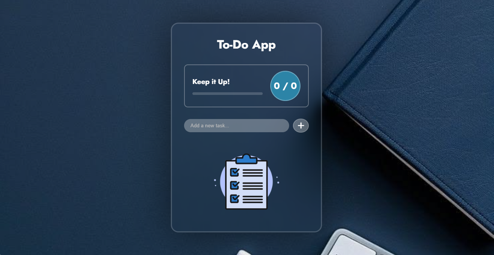

# Todo App

A simple and thoughtful Todo app I built to practice JavaScript and improve everyday productivity. The idea was to keep it minimal, fast, and easy to use on any device.

## Live Demo
https://khalilah-jolaosho.github.io/todo-app/

## Why I Built This
I wanted to understand how JavaScript handles real user interactions — adding, completing, and removing tasks — while keeping the code clean and readable. This app helped me practice DOM manipulation and local storage.

## Features
- Add new tasks quickly
- Mark tasks as complete
- Delete tasks you no longer need
- Saves tasks automatically so they stay after you refresh
- Works well on mobile, tablet, and desktop

## Built With
- HTML5
- CSS3
- JavaScript

## Project Structure
To-Do List App_2/
├── Assets/
├── index.html
├── style.css
├── script.js
├── todo-screenshot.png
└── README.md